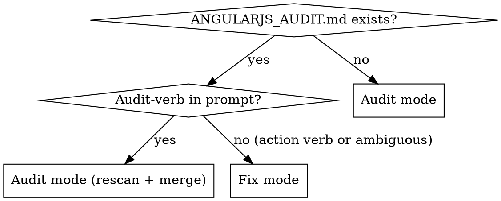

# AngularJS 1.x Audit

Audit an AngularJS 1.x codebase against known anti-patterns that cause instability, memory leaks, digest-cycle errors, and silent data corruption. Output is a durable punch list at the repo root: `ANGULARJS_AUDIT.md`.

## Mode dispatch



When dispatched ambiguously to fix mode, tell the user once: *"Working from the existing audit. Pass `--rescan` to refresh findings, or `--fresh` to start over."* `--fresh` always routes to audit mode and skips merge.

---

## Rulebook

The rules below are organized into categories. Each rule has a label, severity, and description with example code showing the anti-pattern and the correct alternative.

---

### Category 1 — Scope & Data Binding

#### Rule: Primitive binding in child scope (no dot rule)

Binding a primitive value with `ng-model` inside a directive that creates a child scope (`ng-if`, `ng-repeat`, `ng-switch`, `ng-include`) causes the child scope to shadow the parent's property. Changes in the child are invisible to the parent.

**Anti-pattern:**

```html
<!-- Controller sets $scope.name = 'Alice' -->
<div ng-controller="MainCtrl">
  <input ng-model="name">        <!-- works -->
  <div ng-if="showForm">
    <input ng-model="name">      <!-- BROKEN: writes to child scope copy -->
  </div>
</div>
```

```js
function MainCtrl($scope) {
  $scope.name = 'Alice';
  $scope.showForm = true;
}
```

**Correct:**

```html
<div ng-controller="MainCtrl as vm">
  <input ng-model="vm.user.name">
  <div ng-if="vm.showForm">
    <input ng-model="vm.user.name">  <!-- writes through to controller object -->
  </div>
</div>
```

```js
function MainCtrl() {
  this.user = { name: 'Alice' };
  this.showForm = true;
}
```

#### Rule: Not using controllerAs syntax

Using `$scope` directly instead of `controllerAs` makes scope inheritance bugs harder to detect, couples the controller to `$scope`, and makes it difficult to identify which controller owns a property in nested views.

**Anti-pattern:**

```js
angular.module('app').controller('UserCtrl', function ($scope) {
  $scope.user = { name: 'Alice' };
  $scope.save = function () {
    UserService.save($scope.user);
  };
});
```

```html
<div ng-controller="UserCtrl">
  <p>{{ user.name }}</p>
</div>
```

**Correct:**

```js
angular.module('app').controller('UserCtrl', function (UserService) {
  var vm = this;
  vm.user = { name: 'Alice' };
  vm.save = function () {
    UserService.save(vm.user);
  };
});
```

```html
<div ng-controller="UserCtrl as vm">
  <p>{{ vm.user.name }}</p>
</div>
```

#### Rule: Abusing $rootScope as a global store

Storing shared state on `$rootScope` instead of using a dedicated service. Every property on `$rootScope` is evaluated during every `$digest` cycle across all scopes. It also creates hidden coupling — any controller can silently overwrite any `$rootScope` property.

**Anti-pattern:**

```js
angular.module('app').run(function ($rootScope) {
  $rootScope.currentUser = null;
  $rootScope.appConfig = {};
  $rootScope.notifications = [];
});

// In some controller
angular.module('app').controller('NavCtrl', function ($rootScope) {
  $rootScope.currentUser = AuthService.getUser();
});
```

**Correct:**

```js
angular.module('app').factory('UserSession', function () {
  var session = {
    currentUser: null,
    setUser: function (user) { session.currentUser = user; },
    clear: function () { session.currentUser = null; }
  };
  return session;
});

angular.module('app').controller('NavCtrl', function (UserSession, AuthService) {
  UserSession.setUser(AuthService.getUser());
});
```

#### Rule: Using $parent to access parent scope

Navigating scope hierarchy with `$scope.$parent` or `$parent` in templates creates brittle, position-dependent code. Adding or removing a directive that creates a child scope (`ng-if`, `ng-repeat`) silently breaks the reference chain.

**Anti-pattern:**

```html
<div ng-controller="ParentCtrl">
  <div ng-if="showChild">
    <div ng-controller="ChildCtrl">
      <!-- Fragile: assumes exactly one intermediate scope -->
      <p>{{ $parent.$parent.parentValue }}</p>
    </div>
  </div>
</div>
```

**Correct:**

```html
<div ng-controller="ParentCtrl as parent">
  <div ng-if="parent.showChild">
    <div ng-controller="ChildCtrl as child">
      <p>{{ parent.parentValue }}</p>
    </div>
  </div>
</div>
```

---

### Category 2 — Digest Cycle & Watchers

#### Rule: Unregistered $rootScope watchers / listeners

Attaching `$watch`, `$on`, or `$broadcast` listeners to `$rootScope` from a controller or directive without deregistering on `$destroy`. The `$rootScope` lives for the entire app lifetime — orphaned listeners accumulate and fire on destroyed scopes, causing errors and memory leaks.

**Anti-pattern:**

```js
angular.module('app').controller('ChatCtrl', function ($rootScope, $scope) {
  // This listener is NEVER cleaned up when ChatCtrl is destroyed
  $rootScope.$on('newMessage', function (event, msg) {
    $scope.messages.push(msg);  // $scope may already be destroyed!
  });
});
```

**Correct:**

```js
angular.module('app').controller('ChatCtrl', function ($rootScope, $scope) {
  var deregister = $rootScope.$on('newMessage', function (event, msg) {
    $scope.messages.push(msg);
  });

  $scope.$on('$destroy', function () {
    deregister();
  });
});
```

#### Rule: Uncancelled $timeout / $interval

Creating `$timeout` or `$interval` handles without cancelling them in the `$destroy` handler. After the scope is destroyed, the callback still fires — operating on a dead scope, triggering `$apply` on a destroyed `$rootScope` child, and leaking memory.

**Anti-pattern:**

```js
angular.module('app').controller('DashboardCtrl', function ($scope, $interval, StatsService) {
  // This interval keeps firing even after navigating away
  $interval(function () {
    StatsService.refresh().then(function (data) {
      $scope.stats = data;  // scope may be destroyed
    });
  }, 5000);
});
```

**Correct:**

```js
angular.module('app').controller('DashboardCtrl', function ($scope, $interval, StatsService) {
  var pollHandle = $interval(function () {
    StatsService.refresh().then(function (data) {
      $scope.stats = data;
    });
  }, 5000);

  $scope.$on('$destroy', function () {
    $interval.cancel(pollHandle);
  });
});
```

#### Rule: Too many watchers / missing one-time bindings

Every `{{ expression }}` and `ng-bind` creates a watcher. Large lists without one-time bindings (`::`) cause digest cycles to take hundreds of milliseconds, freezing the UI. Beyond ~2000 active watchers, digest performance degrades sharply.

**Anti-pattern:**

```html
<!-- Each iteration creates 3 watchers that persist for the list's lifetime -->
<li ng-repeat="item in items">
  <span>{{ item.name }}</span>
  <span>{{ item.category }}</span>
  <span>{{ item.description }}</span>
</li>
```

**Correct:**

```html
<!-- One-time bindings: watcher is removed after first stable evaluation -->
<li ng-repeat="item in ::items">
  <span>{{ ::item.name }}</span>
  <span>{{ ::item.category }}</span>
  <span>{{ ::item.description }}</span>
</li>
```

**Note:** Only use `::` when the value will not change after initial render. For mutable data, keep the watcher.

#### Rule: Deep watch on large objects

Using `$scope.$watch(expr, fn, true)` (third argument `true`) performs a deep-equality check via `angular.copy` + `angular.equals` on every digest. On large arrays or deeply nested objects this is extremely expensive and often causes the "10 $digest() iterations reached" error.

**Anti-pattern:**

```js
// Deep-watching an array of 500+ items — copies entire array every digest
$scope.$watch('items', function (newVal, oldVal) {
  $scope.total = calculateTotal(newVal);
}, true);
```

**Correct:**

```js
// Watch a derived value or use $watchCollection for shallow array changes
$scope.$watchCollection('items', function (newVal, oldVal) {
  $scope.total = calculateTotal(newVal);
});

// Or for computed values, watch the specific property
$scope.$watch('items.length', function (newLen) {
  $scope.total = calculateTotal($scope.items);
});
```

#### Rule: Calling $apply inside a digest cycle

Calling `$scope.$apply()` or `$rootScope.$apply()` when a `$digest` is already in progress throws the `$digest already in progress` error. This typically happens inside `$watch` callbacks, directive link functions during compilation, or in promise `.then()` handlers from Angular services.

**Anti-pattern:**

```js
$scope.$watch('query', function (newVal) {
  // ERROR: $digest already in progress
  $scope.$apply(function () {
    $scope.results = search(newVal);
  });
});
```

**Correct:**

```js
// If already inside Angular context, just update — no $apply needed
$scope.$watch('query', function (newVal) {
  $scope.results = search(newVal);
});

// For genuinely external code (DOM events, third-party libs), use $applyAsync
element.on('scroll', function () {
  $scope.$applyAsync(function () {
    $scope.scrollPos = element.scrollTop();
  });
});
```

#### Rule: Function calls in template expressions

Calling functions in `{{ }}` interpolation or `ng-bind` expressions. The function executes on **every single digest cycle** — potentially dozens of times per user interaction. If the function is non-trivial (filtering, sorting, HTTP calls), it causes severe performance degradation.

**Anti-pattern:**

```html
<!-- getFullName() runs on EVERY digest cycle -->
<span>{{ getFullName() }}</span>
<span>{{ items | filter:search | orderBy:'name' }}</span>

<!-- Even worse: triggering side effects from a template expression -->
<span>{{ logAndReturn(user.name) }}</span>
```

```js
$scope.getFullName = function () {
  // Runs 5-30+ times per keystroke
  return $scope.user.first + ' ' + $scope.user.last;
};
```

**Correct:**

```js
// Pre-compute and store as a scope property
$scope.$watchGroup(['user.first', 'user.last'], function (vals) {
  $scope.fullName = vals[0] + ' ' + vals[1];
});

// Or compute once in the controller
$scope.fullName = $scope.user.first + ' ' + $scope.user.last;
```

```html
<span>{{ fullName }}</span>
```

#### Rule: Not using $applyAsync for batched HTTP responses

When multiple `$http` calls resolve at roughly the same time, each triggers its own `$digest` cycle. Enabling `$httpProvider.useApplyAsync(true)` batches these into a single cycle.

**Anti-pattern:**

```js
// Three HTTP calls, three separate digest cycles on resolve
angular.module('app').controller('DashCtrl', function ($http, $scope) {
  $http.get('/api/users').then(function (r) { $scope.users = r.data; });
  $http.get('/api/stats').then(function (r) { $scope.stats = r.data; });
  $http.get('/api/config').then(function (r) { $scope.config = r.data; });
});
```

**Correct:**

```js
angular.module('app').config(function ($httpProvider) {
  $httpProvider.useApplyAsync(true);
});
```

---

### Category 3 — Memory Leaks & Cleanup

#### Rule: DOM references not nullified on $destroy

Storing DOM element references in scope or closure variables from a directive's link function without nullifying them on `$destroy`. The reference keeps the detached DOM tree in memory (visible as "Detached DOM tree" in Chrome heap snapshots).

**Anti-pattern:**

```js
angular.module('app').directive('chart', function ($timeout) {
  return {
    link: function (scope, element) {
      var canvas = element.find('canvas')[0];
      var chartInstance = new Chart(canvas, { /* ... */ });

      // canvas and chartInstance are never cleaned up
    }
  };
});
```

**Correct:**

```js
angular.module('app').directive('chart', function () {
  return {
    link: function (scope, element) {
      var canvas = element.find('canvas')[0];
      var chartInstance = new Chart(canvas, { /* ... */ });

      scope.$on('$destroy', function () {
        chartInstance.destroy();
        chartInstance = null;
        canvas = null;
      });

      element.on('$destroy', function () {
        // jQuery plugin cleanup goes here
      });
    }
  };
});
```

#### Rule: Event listeners not removed on $destroy

Adding vanilla JS or jQuery event listeners in a directive without removing them when the directive is destroyed. Handlers continue to fire and reference the dead scope.

**Anti-pattern:**

```js
angular.module('app').directive('scrollTracker', function ($window) {
  return {
    link: function (scope, element) {
      // This handler is NEVER removed
      angular.element($window).on('scroll', function () {
        scope.$apply(function () {
          scope.scrollY = $window.pageYOffset;
        });
      });
    }
  };
});
```

**Correct:**

```js
angular.module('app').directive('scrollTracker', function ($window) {
  return {
    link: function (scope, element) {
      var onScroll = function () {
        scope.$applyAsync(function () {
          scope.scrollY = $window.pageYOffset;
        });
      };

      angular.element($window).on('scroll', onScroll);

      scope.$on('$destroy', function () {
        angular.element($window).off('scroll', onScroll);
      });
    }
  };
});
```

#### Rule: $broadcast / $emit flooding

Using `$rootScope.$broadcast` to communicate between components. Every `$broadcast` walks the **entire scope tree**. In a large application with hundreds of scopes, frequent broadcasts (e.g., on scroll, on digest) cause measurable latency. Also, listeners that aren't cleaned up keep accumulating.

**Anti-pattern:**

```js
// Broadcasting on every scroll event — walks entire scope tree each time
angular.element($window).on('scroll', function () {
  $rootScope.$broadcast('scrollEvent', { y: $window.pageYOffset });
  $rootScope.$digest();
});
```

**Correct:**

```js
// Use a service with an observable pattern instead
angular.module('app').factory('ScrollService', function ($window) {
  var callbacks = [];
  angular.element($window).on('scroll', function () {
    var y = $window.pageYOffset;
    callbacks.forEach(function (cb) { cb(y); });
  });
  return {
    onScroll: function (cb) {
      callbacks.push(cb);
      return function deregister() {
        var idx = callbacks.indexOf(cb);
        if (idx > -1) callbacks.splice(idx, 1);
      };
    }
  };
});
```

---

### Category 4 — Dependency Injection & Minification

#### Rule: Non-annotated injection (minification-unsafe)

Relying on AngularJS's implicit function-parameter-name injection. Minifiers rename parameters, breaking injection silently at runtime with cryptic "Unknown provider" errors.

**Anti-pattern:**

```js
// Minifier renames $scope to 'a', $http to 'b' — breaks at runtime
angular.module('app').controller('MainCtrl', function ($scope, $http, UserService) {
  // ...
});
```

**Correct (inline array annotation):**

```js
angular.module('app').controller('MainCtrl', ['$scope', '$http', 'UserService',
  function ($scope, $http, UserService) {
    // ...
  }
]);
```

**Correct (ng-annotate + strict DI):**

```js
/* @ngInject */
function MainCtrl($scope, $http, UserService) {
  // ...
}
angular.module('app').controller('MainCtrl', MainCtrl);
```

```html
<!-- Enable strict DI to fail fast on missing annotations -->
<div ng-app="myApp" ng-strict-di></div>
```

#### Rule: Not using strict DI mode

Without strict DI mode, missing annotations fail silently in development and only break after minification in production — the worst possible time.

**Anti-pattern:**

```html
<div ng-app="myApp"></div>
```

**Correct:**

```html
<div ng-app="myApp" ng-strict-di></div>
```

```js
// Or via bootstrap
angular.bootstrap(document, ['myApp'], {
  strictDi: true
});
```

---

### Category 5 — Services & Architecture

#### Rule: Business logic in controllers

Controllers that contain HTTP calls, data transformation, validation, or other business logic directly. Controllers should be thin — they wire the view to services. Fat controllers are untestable, non-reusable, and lead to code duplication across views.

**Anti-pattern:**

```js
angular.module('app').controller('OrderCtrl', function ($scope, $http) {
  $scope.submit = function () {
    // Validation logic in controller
    if (!$scope.order.items.length) {
      $scope.error = 'Cart is empty';
      return;
    }
    var total = 0;
    $scope.order.items.forEach(function (item) {
      total += item.price * item.qty;
    });
    if (total > $scope.user.creditLimit) {
      $scope.error = 'Over credit limit';
      return;
    }
    // HTTP call in controller
    $http.post('/api/orders', $scope.order).then(function (res) {
      $scope.confirmation = res.data;
    });
  };
});
```

**Correct:**

```js
angular.module('app').factory('OrderService', ['$http', function ($http) {
  return {
    validate: function (order, user) {
      if (!order.items.length) return 'Cart is empty';
      var total = order.items.reduce(function (sum, i) { return sum + i.price * i.qty; }, 0);
      if (total > user.creditLimit) return 'Over credit limit';
      return null;
    },
    submit: function (order) {
      return $http.post('/api/orders', order);
    }
  };
}]);

angular.module('app').controller('OrderCtrl', ['$scope', 'OrderService',
  function ($scope, OrderService) {
    $scope.submit = function () {
      var err = OrderService.validate($scope.order, $scope.user);
      if (err) { $scope.error = err; return; }
      OrderService.submit($scope.order).then(function (res) {
        $scope.confirmation = res.data;
      });
    };
  }
]);
```

#### Rule: Using $http directly without error handling

Every `$http` call that lacks a `.catch()` or error callback silently swallows server errors. The user sees a frozen UI with no feedback.

**Anti-pattern:**

```js
$http.get('/api/users').then(function (response) {
  $scope.users = response.data;
});
// If the server returns 500, nothing happens — no error, no feedback
```

**Correct:**

```js
$http.get('/api/users').then(
  function (response) {
    $scope.users = response.data;
  },
  function (error) {
    $scope.loadError = 'Failed to load users. Please try again.';
    $log.error('Failed to fetch users:', error.status, error.data);
  }
);
```

#### Rule: Manual promise construction ($q.defer anti-pattern)

Wrapping an existing promise (from `$http` or another service) in a redundant `$q.defer()`. This adds unnecessary complexity, makes error propagation fragile (errors from the inner promise are often swallowed), and leaks deferred objects.

**Anti-pattern:**

```js
angular.module('app').factory('UserService', function ($http, $q) {
  return {
    getUser: function (id) {
      var deferred = $q.defer();
      $http.get('/api/users/' + id).then(function (response) {
        deferred.resolve(response.data);
      }, function (error) {
        deferred.reject(error);
      });
      return deferred.promise;
      // If the error callback is omitted, errors are silently swallowed
    }
  };
});
```

**Correct:**

```js
angular.module('app').factory('UserService', ['$http', function ($http) {
  return {
    getUser: function (id) {
      return $http.get('/api/users/' + id).then(function (response) {
        return response.data;
      });
      // Errors propagate naturally through the promise chain
    }
  };
}]);
```

---

### Category 6 — Directives

#### Rule: DOM manipulation in controllers

Manipulating DOM directly in a controller (via jQuery, `document.querySelector`, or jqLite). Controllers should not know about the DOM. This breaks testability, prevents reuse, and causes issues when Angular replaces DOM nodes during compilation.

**Anti-pattern:**

```js
angular.module('app').controller('FormCtrl', function ($scope) {
  $scope.highlightError = function () {
    // Direct DOM manipulation in controller
    angular.element(document.querySelector('.form-input')).addClass('error');
    document.getElementById('submit-btn').disabled = true;
  };
});
```

**Correct:**

```js
angular.module('app').controller('FormCtrl', function ($scope) {
  $scope.hasError = false;
  $scope.isSubmitDisabled = false;
});
```

```html
<input class="form-input" ng-class="{ error: hasError }">
<button id="submit-btn" ng-disabled="isSubmitDisabled">Submit</button>
```

#### Rule: Overusing isolated scope

Applying isolated scope to directives that only appear once per element or that need to interact with sibling directives. Two isolated-scope directives on the same element cause a compilation error. Isolated scope also blocks prototypal inheritance, breaking `ng-if` / `ng-repeat` interactions.

**Anti-pattern:**

```js
// Two isolated-scope directives on the same element = ERROR
angular.module('app').directive('tooltipBehavior', function () {
  return {
    scope: {},  // isolated — but this is just a behavioral enhancement
    link: function (scope, element) { /* ... */ }
  };
});

angular.module('app').directive('draggable', function () {
  return {
    scope: {},  // isolated — another one on the same element = crash
    link: function (scope, element) { /* ... */ }
  };
});
```

```html
<!-- ERROR: Multiple directives requesting isolated scope -->
<div tooltip-behavior draggable></div>
```

**Correct:**

```js
// Behavioral directives should not use isolated scope
angular.module('app').directive('tooltipBehavior', function () {
  return {
    restrict: 'A',
    // No scope property — shares parent scope
    link: function (scope, element, attrs) {
      // Read config from attributes
      var placement = attrs.tooltipPlacement || 'top';
    }
  };
});
```

#### Rule: Two-way binding where one-way suffices

Using `=` (two-way) binding in directive scope when the directive only reads the value. This creates unnecessary watchers and risks accidental mutation of parent state.

**Anti-pattern:**

```js
angular.module('app').directive('userCard', function () {
  return {
    scope: {
      user: '='  // two-way, but this directive never writes to user
    },
    template: '<div>{{ user.name }}</div>'
  };
});
```

**Correct (AngularJS 1.5+ component):**

```js
angular.module('app').component('userCard', {
  bindings: {
    user: '<'  // one-way binding — no back-propagation
  },
  template: '<div>{{ $ctrl.user.name }}</div>'
});
```

---

### Category 7 — Routing & State Management

#### Rule: Resolve blocking all view rendering

Putting slow API calls in `resolve` blocks every nested view from rendering until all resolves complete. Users see a blank screen with no feedback.

**Anti-pattern:**

```js
$stateProvider.state('dashboard', {
  url: '/dashboard',
  controller: 'DashCtrl',
  templateUrl: 'dashboard.html',
  resolve: {
    userData: function (UserService) {
      return UserService.getProfile();        // 800ms
    },
    analyticsData: function (AnalyticsService) {
      return AnalyticsService.getMetrics();   // 2000ms
    },
    notificationsData: function (NotificationService) {
      return NotificationService.getAll();    // 1500ms
    }
  }
});
// User sees blank screen for 2+ seconds
```

**Correct:**

```js
$stateProvider.state('dashboard', {
  url: '/dashboard',
  controller: 'DashCtrl',
  templateUrl: 'dashboard.html',
  resolve: {
    // Only resolve what's absolutely needed before render
    userData: ['UserService', function (UserService) {
      return UserService.getProfile();
    }]
  }
});

// Load non-critical data in the controller
angular.module('app').controller('DashCtrl', ['$scope', 'userData', 'AnalyticsService', 'NotificationService',
  function ($scope, userData, AnalyticsService, NotificationService) {
    $scope.user = userData;
    $scope.analyticsLoading = true;

    AnalyticsService.getMetrics().then(function (data) {
      $scope.analytics = data;
      $scope.analyticsLoading = false;
    });

    NotificationService.getAll().then(function (data) {
      $scope.notifications = data;
    });
  }
]);
```

#### Rule: Debug info enabled in production

AngularJS attaches scope references and CSS classes to DOM nodes by default for debugging tools. In production this is a performance and security concern — scope data is accessible to anyone via the browser console.

**Anti-pattern:**

```js
// No production configuration — debug info is ON by default
angular.module('app', []);
```

**Correct:**

```js
angular.module('app', []).config(['$compileProvider', function ($compileProvider) {
  // Disable debug info in production for performance and security
  $compileProvider.debugInfoEnabled(false);
}]);
```

---

### Category 8 — Error Handling & Resilience

#### Rule: Unhandled promise rejections in $q chains

Promise chains that lack terminal `.catch()` handlers. Rejected promises propagate silently — no error logged, no user feedback, no diagnostic information.

**Anti-pattern:**

```js
UserService.getProfile()
  .then(function (profile) {
    return OrderService.getOrders(profile.id);
  })
  .then(function (orders) {
    $scope.orders = orders;
  });
// If any step rejects, the error vanishes silently
```

**Correct:**

```js
UserService.getProfile()
  .then(function (profile) {
    return OrderService.getOrders(profile.id);
  })
  .then(function (orders) {
    $scope.orders = orders;
  })
  .catch(function (error) {
    $scope.loadError = true;
    $log.error('Order loading failed:', error);
  });
```

#### Rule: Missing $exceptionHandler override

AngularJS's default `$exceptionHandler` just logs to `console.error`. In production, uncaught exceptions should be reported to an error-tracking service. Without this, production errors go unnoticed.

**Anti-pattern:**

```js
// Default behavior: exceptions logged to console, never reported
angular.module('app', []);
```

**Correct:**

```js
angular.module('app').factory('$exceptionHandler', ['$log', function ($log) {
  return function (exception, cause) {
    $log.error(exception, cause);
    // Send to error tracking service
    if (window.Sentry) {
      Sentry.captureException(exception);
    }
  };
}]);
```

#### Rule: Swallowing errors in $http interceptors

HTTP interceptors that transform or suppress error responses without re-rejecting. Downstream `.catch()` handlers never fire, making the app appear to work while data is silently missing.

**Anti-pattern:**

```js
angular.module('app').factory('httpInterceptor', function ($q) {
  return {
    responseError: function (rejection) {
      if (rejection.status === 401) {
        // redirect to login... but forgets to re-reject
        window.location.href = '/login';
        // Missing: return $q.reject(rejection);
      }
      // Non-401 errors are silently swallowed because nothing is returned
    }
  };
});
```

**Correct:**

```js
angular.module('app').factory('httpInterceptor', ['$q', '$injector', function ($q, $injector) {
  return {
    responseError: function (rejection) {
      if (rejection.status === 401) {
        var $state = $injector.get('$state');
        $state.go('login');
      }
      // Always re-reject so callers can handle it
      return $q.reject(rejection);
    }
  };
}]);
```

---

### Category 9 — Performance & Rendering

#### Rule: Heavy computation on the main thread

Running expensive computations (sorting large arrays, parsing large datasets, complex transformations) synchronously in controllers or services. This blocks the digest cycle and freezes the UI.

**Anti-pattern:**

```js
$scope.processData = function () {
  // Blocks the UI for 2+ seconds on large datasets
  $scope.results = $scope.rawData
    .filter(function (item) { return complexFilter(item); })
    .map(function (item) { return expensiveTransform(item); })
    .sort(function (a, b) { return a.score - b.score; });
};
```

**Correct:**

```js
// Offload to a Web Worker
angular.module('app').factory('DataProcessor', ['$q', function ($q) {
  return {
    process: function (data) {
      var deferred = $q.defer();
      var worker = new Worker('data-processor.worker.js');
      worker.postMessage(data);
      worker.onmessage = function (e) {
        deferred.resolve(e.data);
        worker.terminate();
      };
      worker.onerror = function (e) {
        deferred.reject(e);
        worker.terminate();
      };
      return deferred.promise;
    }
  };
}]);
```

#### Rule: Filters in ng-repeat without track by

Using `ng-repeat` without `track by` causes AngularJS to destroy and re-create DOM nodes on every digest even when the underlying objects haven't changed — only their identity (reference) has. Combined with filters, this re-renders the entire list on every keystroke.

**Anti-pattern:**

```html
<!-- Destroys and re-creates every <li> when items array is re-fetched -->
<li ng-repeat="item in items | filter:search | orderBy:'name'">
  {{ item.name }}
</li>
```

**Correct:**

```html
<li ng-repeat="item in items | filter:search | orderBy:'name' track by item.id">
  {{ item.name }}
</li>
```

---

### Category 10 — Security

#### Rule: Rendering untrusted HTML (XSS)

Passing user-controlled or server-reflected content through `$sce.trustAsHtml` (or `$sce.trustAs`) and binding it with `ng-bind-html` bypasses AngularJS's Strict Contextual Escaping and injects raw markup into the DOM. Any `<script>`, `onerror`, or `javascript:` payload in that content executes — a stored/reflected XSS hole. Only trust values you fully control; for user content, sanitize with the `ngSanitize` module (`$sanitize`) instead of trusting.

**Anti-pattern:**

```js
// comment.body comes from another user — trusting it is an XSS sink
$scope.renderedBody = $sce.trustAsHtml(comment.body);
```

```html
<div ng-bind-html="renderedBody"></div>
```

**Correct:**

```js
// Load ngSanitize, then ng-bind-html strips dangerous markup automatically
angular.module('app', ['ngSanitize']);
$scope.renderedBody = comment.body;  // no trustAsHtml
```

```html
<!-- ngSanitize sanitizes the value before insertion -->
<div ng-bind-html="renderedBody"></div>
```

#### Rule: Disabling Strict Contextual Escaping globally

Calling `$sceProvider.enabled(false)` turns off SCE for the entire application, so every `ng-bind-html` and resource-URL binding renders untrusted content unescaped. This converts a localized escaping decision into an app-wide XSS exposure and is almost never justified.

**Anti-pattern:**

```js
angular.module('app').config(function ($sceProvider) {
  $sceProvider.enabled(false);  // disables XSS protection app-wide
});
```

**Correct:**

```js
// Leave SCE enabled. Whitelist specific trusted resource origins instead.
angular.module('app').config(['$sceDelegateProvider', function ($sceDelegateProvider) {
  $sceDelegateProvider.resourceUrlWhitelist([
    'self',
    'https://trusted-cdn.example.com/**'
  ]);
}]);
```

#### Rule: Open redirect from a server-controlled URL

Assigning a URL that originates from server data, query parameters, or user input directly to `$window.location` / `$location.url()` (or an interceptor redirect) enables open-redirect and `javascript:`-scheme attacks. Validate against an allowlist of known paths before navigating.

**Anti-pattern:**

```js
// returnUrl arrives from the query string — attacker controls it
$window.location.href = $location.search().returnUrl;
```

**Correct:**

```js
var target = $location.search().returnUrl || '/';
// Only allow same-origin, root-relative paths
if (/^\/(?!\/)/.test(target)) {
  $location.url(target);
} else {
  $location.url('/');
}
```

---

## Scoring

Four-level severity scale, applied to all findings.

| Severity | Visual | When |
|---|---|---|
| CRITICAL | 🔴 | Causes crashes, data loss, infinite digest loops, or silent data corruption |
| HIGH | 🟠 | Memory leaks, significant performance degradation, or reliability issues under load |
| MEDIUM | 🟡 | Moderate impact on performance or maintainability; latent bugs |
| LOW | 🟢 | Code hygiene, style, or minor inefficiencies |

Confidence is 0–100, independent of severity. **Below 50: don't report.** 50–69 probable but legitimate use possible. 70–89 pattern clear, surrounding code partially unverified. 90+ textbook match.

**Calibration table:**

| Pattern | Severity | Why |
|---|---|---|
| Primitive binding in child scope | CRITICAL | Silent data corruption — user changes are invisibly lost |
| Non-annotated injection | CRITICAL | App breaks after minification in production |
| Unregistered $rootScope listeners | HIGH | Memory leak + errors on destroyed scope |
| Uncancelled $timeout / $interval | HIGH | Fires on destroyed scope, memory leak |
| DOM references not nullified | HIGH | Detached DOM tree memory leak |
| Event listeners not removed | HIGH | Memory leak + stale scope access |
| Deep watch on large objects | HIGH | Digest performance, potential infinite loop |
| $apply inside digest | HIGH | Throws error, breaks digest cycle |
| Abusing $rootScope as store | HIGH | Evaluated every digest, hidden coupling |
| Using $parent | MEDIUM | Fragile, breaks on scope structure changes |
| Function calls in expressions | MEDIUM | Runs every digest, performance drain |
| Missing one-time bindings | MEDIUM | Excessive watchers on static content |
| Business logic in controllers | MEDIUM | Untestable, non-reusable |
| $q.defer anti-pattern | MEDIUM | Error swallowing, unnecessary complexity |
| Missing error handling on $http | MEDIUM | Silent failures, frozen UI |
| Swallowing errors in interceptors | HIGH | Downstream handlers never fire |
| Resolve blocking rendering | MEDIUM | Poor perceived performance |
| Debug info in production | LOW | Performance + security info leak |
| Not using controllerAs | LOW | Style, but masks scope bugs |
| DOM manipulation in controllers | MEDIUM | Breaks testability, coupling |
| Overusing isolated scope | MEDIUM | Blocks composition of directives |
| Missing $exceptionHandler | LOW | Production errors go unnoticed |
| Filters without track by | MEDIUM | Unnecessary DOM churn |
| $broadcast flooding | MEDIUM | Performance on large scope trees |
| Missing strict DI | LOW | Delayed failure discovery |
| Rendering untrusted HTML | CRITICAL | XSS — arbitrary script execution |
| Disabling SCE globally | CRITICAL | App-wide XSS exposure |
| Open redirect from server URL | HIGH | Open redirect / `javascript:` scheme attack |

---

## Audit mode

1. **Determine scope.** Honor any user-named directory or glob exactly. Otherwise scan the entire repo. Note actual scope in the audit file's `scope:` frontmatter. **`files_examined`** = count of `.js`, `.html`, and `.ts` files within the scope. Compute with:
   ```
   find <scope> -type f \( -name '*.js' -o -name '*.html' -o -name '*.ts' \) ! -name '*.min.js' ! -path '*/node_modules/*' ! -path '*/bower_components/*' ! -path '*/vendor/*' | wc -l
   ```
   Also detect the AngularJS version (check `package.json`, `bower.json`, or the header comment of a vendored `angular.js`) and record it in the audit file's `angularjs_version:` frontmatter. **Gate version-specific advice:** when the detected version is below a rule's minimum, do not recommend that fix — note the constraint instead. Minimums: `::` one-time bindings need **1.3+**; `component()` and `<` one-way bindings need **1.5+**; `$applyAsync` / `$httpProvider.useApplyAsync` / `$compileProvider.debugInfoEnabled` / `ng-strict-di` need **1.3+**. If the version can't be determined, record `unknown` and proceed without gating.

2. **Sweep per anti-pattern, not per file.** For each rule, run a targeted search across the entire scope. Codebases typically have 3–10 near-identical violations of the same rule — don't stop at the first hit.

3. **Search signatures.** Use these grep patterns as starting points:

   | Rule | Signature |
   |---|---|
   | Primitive binding (no dot) | `grep -rnE 'ng-model="[a-zA-Z_]+[^.]"'` in HTML files |
   | Unregistered $rootScope listeners | `grep -rn '\$rootScope\.\$on'` then check for missing `$destroy` cleanup |
   | Uncancelled $timeout/$interval | `grep -rn '\$interval\|\$timeout'` then check for `$destroy` + `.cancel()` |
   | Non-annotated injection | `grep -rnE '\.(controller|factory|service|directive|filter|config|run)\s*\([^[]*function\s*\('` |
   | Deep watch | `grep -rn '\$watch.*true\s*\)'` |
   | $apply inside digest | `grep -rn '\$apply\s*('` then verify context |
   | DOM in controllers | `grep -rnE 'document\.(querySelector|getElementById)|angular\.element\(document' ` in controller files |
   | $rootScope as store | `grep -rn '\$rootScope\.'` then check for data storage vs events |
   | $parent references | `grep -rnE '\$parent\b'` in HTML and JS files |
   | Missing one-time bindings | `grep -rnE '\{\{\s*[^:][^}]+\}\}'` in `ng-repeat` blocks, check for `::` |
   | Function in expression | `grep -rnE '\{\{.*\(.*\).*\}\}'` then verify non-trivial body |
   | $q.defer anti-pattern | `grep -rn '\$q\.defer\(\)'` then check if wrapping existing promise |
   | Missing error handling | `grep -rn '\$http\.'` then check for missing `.catch` or error callback |
   | Debug info | `grep -rn 'debugInfoEnabled'` — absence means ON |
   | strict DI | `grep -rn 'ng-strict-di\|strictDi'` — absence means OFF |
   | Rendering untrusted HTML | `grep -rn 'trustAsHtml\|trustAs(' ` then verify the source is user/server data |
   | Disabling SCE globally | `grep -rn '\$sceProvider' ` then check for `.enabled(false)` |
   | Open redirect | `grep -rnE 'location\.(href\|url)\s*=|\$location\.url\('` then check the value's origin |

4. **Score** each finding (severity + confidence). Discard <50 confidence.

5. **Enumerate-or-exclude verification.** For every rule with ≥1 finding, review the raw grep output. Label every match: `→ AJ-NNN`, `excluded: <reason>`, or `duplicate of AJ-NNN`.

6. **Write `ANGULARJS_AUDIT.md`** at the repo root using the format below. **Zero findings:** don't write the file. Print: *"Audited <N> files across <scope>. No findings — code looks consistent with AngularJS best practices."*

### Rescan (existing file + audit verb, or `--rescan`)

1. Read existing file. Parse Summary table for every entry's ID and Status.
2. Run audit (steps 1–5).
3. Merge by `(file path, rule label, snippet fingerprint)`:
   - **Match → Open or Resolved:** keep ID and status; update line numbers.
   - **Match → Dismissed, snippet still matches:** stays Dismissed.
   - **Match → Dismissed, snippet changed materially:** flip to `Open` with note.
   - **No match:** new ID continuing the sequence.
4. Items currently `Open` with no match → flip to `Resolved` with note.
5. Re-sort and recompute frontmatter.

`--fresh` skips merge entirely.

---

## Fix mode

Per item:

1. **Pick.** User named an ID? Use it. Otherwise show the Open list and ask. Suggest the first by sort order.
2. **Verify the violation.** Read the file around the recorded line. Compare to stored snippet:
   - **Matches** → propose fix.
   - **Materially different** → show both, offer re-classify / skip / proceed.
   - **Gone** → offer auto-resolve, dismiss, or re-audit.
3. **Propose** the fix as a diff. Apply only with user approval.
4. **Apply** the edit. Don't commit.
5. **Update the audit file:** change Status to `Resolved`, prepend `*resolved YYYY-MM-DD: <summary>*`.
6. **Suggest next.** Tell user the next ID by sort order. Ask whether to continue.

**Dismissing in fix mode** — no code edit: change Status to `Dismissed`, prepend `*dismissed YYYY-MM-DD: <reason>*`.

---

## Audit file format

Path: `ANGULARJS_AUDIT.md` at the repo root.

```markdown
---
generated: YYYY-MM-DD
scope: <scanned scope>
angularjs_version: <x.y.z | unknown>
files_examined: <N>
findings_total: <M>
open: <count>
resolved: <count>
dismissed: <count>
---

# AngularJS Audit

## How findings are scored

Severity: CRITICAL (crashes, data loss, infinite loops), HIGH (memory leaks, significant perf), MEDIUM (moderate impact, latent bugs), LOW (hygiene). Confidence 0–100; below 50 not reported.

Status is tracked in the Summary table below. To dismiss a finding, change its status cell to `Dismissed` and add a `*dismissed YYYY-MM-DD: <reason>*` line under its detail block.

## Summary

| ID | Severity | Confidence | Status |
|---|---|---|---|
| [AJ-001](#aj-001) | 🔴 CRITICAL | 98 | Open |
| [AJ-002](#aj-002) | 🟠 HIGH | 92 | Open |

<a id="aj-001"></a>
- **AJ-001** · 🔴 CRITICAL · 98 · <Rule Label> · `path/file.js:42`

  <one-sentence why>

  ```js
  // minimal snippet
  ```

  **Fix:** <one sentence, or short replacement block>
```

### Structural rules (apply on every write)

- **Stable IDs.** `AJ-001`, `AJ-002`, ... Sequential. Once assigned, never change.
- **Summary table is source of truth for status.**
- **Summary table sort:** Status (Open → Resolved → Dismissed), then severity (CRITICAL > HIGH > MEDIUM > LOW), then confidence descending.
- **Finding order in body** matches Summary table order.
- **Each finding has an `<a id="aj-nnn"></a>` anchor** directly above its bullet.
- **Header line shape:** `- **AJ-NNN** · <visual> SEVERITY · <confidence> · <Rule Label> · \`path/file.js:line\``
- **Frontmatter counts** recomputed from Summary table on every write.
- **File paths** relative to repo root, with line number.
- **Code snippets** minimal — offending lines plus enough context to read them.

### Family findings (≥3 near-identical violations)

Each gets a separate ID. Entries 2..N: *"Same pattern as AJ-XXX."* Show only file/line and per-instance variation.

---

## Edge cases

- **Test files / generated code** — included by default. Scope narrowing is the user's choice.
- **Third-party code** (`node_modules/`, `bower_components/`, `vendor/`) — always excluded.
- **Minified files** (`*.min.js`) — always excluded.
- **controllerAs is already used** — skip the "not using controllerAs" rule for those controllers but still check for `$scope` injection in them (may be used for `$watch` / `$on` — that's fine).
- **User disagrees with severity** — accept it. Dismiss the item or honor reclassification.
- **$scope used only for $watch/$on/$destroy** — not a controllerAs violation. Label as legitimate use.
- **$rootScope.$on in .run() block** — legitimate if it's app-lifetime state. Don't flag.
- **$broadcast between parent and known child** — use `$scope.$broadcast` (limited tree walk) instead of `$rootScope.$broadcast`. If already scoped, don't flag.
- **Idiom-level vs architectural ownership** — this skill targets *systemic/architectural* anti-patterns (digest performance, memory leaks, scope design, DI, error handling). Narrow, attribute- or expression-level gotchas (e.g. `ng-cloak`, `ng-src` vs `src`, `ngRepeat:dupes`, deprecated/removed APIs, component-lifecycle `$onInit`, TypeScript `static $inject` ordering) belong to the companion **angularjs-gotchas** skill. When a finding is clearly idiom-level, defer to that skill rather than reporting it here, so the two outputs (`ANGULARJS_AUDIT.md` vs `ANGULARJS_GOTCHAS.md`) don't double-report adjacent issues.
- **Build-time DI annotation present** — if the project runs `ng-annotate`, `babel-plugin-angularjs-annotate`, or an equivalent that injects `$inject`/array annotations at build time, the "Non-annotated injection" rule does not apply. Verify the build pipeline before flagging, and skip the rule when annotations are generated.
- **Version-gated advice** — when `angularjs_version` is below a rule's minimum (see Audit mode step 1), don't recommend the version-specific fix; record the finding with a note that the fix requires a newer AngularJS, or skip it.
- **Trusted HTML from a fully controlled source** — `trustAsHtml` on a hard-coded template string or developer-authored constant is not an XSS finding; only flag when the value derives from user input, server responses, or query parameters.
