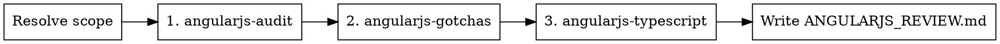

# AngularJS Full Audit (Orchestrator)

Run a complete AngularJS 1.x review by invoking the three companion audit skills in sequence against the same scope, then write a single combined index that links and summarizes all three reports.

This skill **owns no rules of its own.** It is a thin orchestrator: it loads each companion skill's instructions, runs that skill's **Audit mode**, and then aggregates the results. All findings, IDs, scoring, and per-finding output files are produced by the companion skills exactly as if they had been run individually.

## Dependencies

This skill requires all three companion skills to be installed and available to the agent:

| Order | Skill | Output file | ID prefix | Focus |
|---|---|---|---|---|
| 1 | `angularjs-audit` | `ANGULARJS_AUDIT.md` | `AJ-` | Architectural / systemic anti-patterns (digest, watchers, memory, scope, DI minification, security) |
| 2 | `angularjs-gotchas` | `ANGULARJS_GOTCHAS.md` | `AG-` | Small-scale idiom & template gotchas (bindings, coercion, deprecated APIs, lifecycle, DI ordering) |
| 3 | `angularjs-typescript` | `ANGULARJS_TYPESCRIPT.md` | `AT-` | Language / type-system issues (`any`, assertions, strictness, class design, untyped AngularJS surface) |

If any companion skill is not available, tell the user which one is missing and offer to continue with the ones that are present (note the gap in the combined index) or stop.

## Execution sequence



Run the three in the order above (broad architectural → narrow idiom → language/type). The order is for readability of the combined report only; the skills are independent and never collide (separate ID prefixes and separate output files).

### Steps

1. **Resolve scope once.** Honor any user-named directory or glob exactly; otherwise scan the entire repo. Use this identical scope for all three companion skills so their reports are directly comparable. Pass through `--rescan` / `--fresh` flags unchanged to each skill.

2. **For each companion skill, in order:**
   - Load that skill's `SKILL.md` instructions (read it from the installed skill location).
   - Run its **Audit mode** against the resolved scope, following that skill's own rulebook, scoring, verification, and output-file format to the letter. Do not reinterpret or merge its rules here.
   - If the skill is run with an audit verb and its output file already exists, follow that skill's **rescan + merge** behavior (this skill does not override merge semantics).
   - Let the skill write its own output file (`ANGULARJS_AUDIT.md`, etc.). If a skill reports zero findings, it will not write a file — record that as "0 findings" in the combined index.
   - Announce progress between skills (e.g. *"Architectural audit complete — 12 findings. Running idiom/gotcha audit…"*) so the run is legible.

3. **Aggregate.** After all three have run, read back each output file that exists and collect its frontmatter counts (`findings_total`, `open`, `resolved`, `dismissed`) and severity breakdown.

4. **Write the combined index** `ANGULARJS_REVIEW.md` at the repo root using the format below. This index does **not** restate individual findings — it links to the three reports and summarizes totals. Always rewrite it fresh on each full-audit run.

5. **Report** a short top-line summary to the user: total findings across all three, the highest-severity items, and a pointer to `ANGULARJS_REVIEW.md`.

## Combined index format

Path: `ANGULARJS_REVIEW.md` at the repo root.

```markdown
---
generated: YYYY-MM-DD
scope: <scanned scope>
skills_run: [angularjs-audit, angularjs-gotchas, angularjs-typescript]
findings_total: <sum across all reports>
open: <sum>
resolved: <sum>
dismissed: <sum>
---

# AngularJS Full Audit

Combined index for a full AngularJS 1.x review. Each section links to a dedicated report produced by its skill; open those files to view, track, and fix individual findings.

## Totals

| Report | Findings | Open | Resolved | Dismissed |
|---|---|---|---|---|
| [Architecture](./ANGULARJS_AUDIT.md) | <n> | <n> | <n> | <n> |
| [Gotchas](./ANGULARJS_GOTCHAS.md) | <n> | <n> | <n> | <n> |
| [TypeScript](./ANGULARJS_TYPESCRIPT.md) | <n> | <n> | <n> | <n> |
| **Total** | **<N>** | **<N>** | **<N>** | **<N>** |

## Severity breakdown (open findings)

| Report | 🔴 CRITICAL | 🟠 HIGH | 🟡 MEDIUM | 🟢 LOW |
|---|---|---|---|---|
| Architecture | <n> | <n> | <n> | <n> |
| Gotchas | <n> | <n> | <n> | <n> |
| TypeScript | <n> | <n> | <n> | <n> |

## Reports

- **[ANGULARJS_AUDIT.md](./ANGULARJS_AUDIT.md)** — architectural & systemic anti-patterns (`AJ-`).
- **[ANGULARJS_GOTCHAS.md](./ANGULARJS_GOTCHAS.md)** — idiom & template gotchas (`AG-`).
- **[ANGULARJS_TYPESCRIPT.md](./ANGULARJS_TYPESCRIPT.md)** — language & type-system issues (`AT-`).

## Suggested triage order

1. All 🔴 CRITICAL across the three reports.
2. All 🟠 HIGH, starting with `ANGULARJS_AUDIT.md` (runtime-breaking architecture).
3. 🟡 MEDIUM and 🟢 LOW as capacity allows.
```

If a companion skill produced zero findings (no file written), show its row with `0` across the board and link to the report path with a note that it was clean.

## Fixing

This orchestrator runs **audits**, not fixes. To fix findings, the user works through each companion skill's own **Fix mode** against its report file (`ANGULARJS_AUDIT.md`, `ANGULARJS_GOTCHAS.md`, `ANGULARJS_TYPESCRIPT.md`). If the user asks to "fix everything," direct them to fix per report — or invoke each companion skill's fix mode in the same sequence (architecture → gotchas → typescript), one finding at a time, honoring that skill's verify-before-fix workflow. Do not edit code from this skill directly.

## Edge cases

- **Missing companion skill** — name the missing skill, offer to proceed with the rest (noting the gap in `ANGULARJS_REVIEW.md`) or stop. Never silently skip.
- **Mixed pre-existing reports** — if some reports already exist and the run uses an audit verb, each skill independently does its own rescan + merge; this skill only re-aggregates the totals afterward. Existing IDs and statuses are preserved by the companion skills.
- **Scope consistency** — always pass the same resolved scope to all three. If the user changes scope between runs, the combined index reflects the latest run only.
- **Zero findings overall** — if all three report clean, still write `ANGULARJS_REVIEW.md` with all-zero totals and a one-line "No findings — the codebase is clean across all three audits."
- **Vanilla-JS project** — `angularjs-typescript` will auto-detect the absence of `.ts` files and run only its JS-hygiene rules; the combined index reflects whatever it reports. No special handling needed here.
- **No duplication** — this skill must not restate or re-score individual findings. The three reports remain the source of truth for their respective domains; `ANGULARJS_REVIEW.md` is an index, not a fourth findings list.
