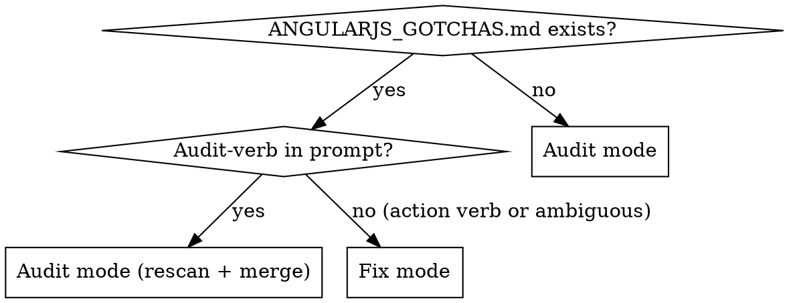

# AngularJS 1.x Gotchas

Audit an AngularJS 1.x codebase (TypeScript or vanilla JavaScript) for small-scale, high-frequency bugs and gotchas that are easy to miss in review: template-binding mistakes, type-coercion bugs, deprecated/removed APIs, component-lifecycle errors, and TypeScript dependency-injection pitfalls. Output is a durable punch list at the repo root: `ANGULARJS_GOTCHAS.md`.

**Scope boundary.** This skill targets *narrow, localized* defects — a single attribute, expression, binding, or injection. Architectural and systemic anti-patterns (digest performance, memory leaks, fat controllers, `$rootScope` abuse, watcher cleanup, isolated-scope composition) belong to the companion **angularjs-audit** skill and are intentionally out of scope here. When a finding is genuinely architectural, defer to that skill rather than duplicating it.

## Mode dispatch



When dispatched ambiguously to fix mode, tell the user once: *"Working from the existing gotcha list. Pass `--rescan` to refresh findings, or `--fresh` to start over."* `--fresh` always routes to audit mode and skips merge.

---

## Rulebook

The rules below are organized into categories. Each rule has a label, severity, and description with example code showing the gotcha and the correct alternative. All examples reflect AngularJS 1.x behavior (current stable: 1.8.x).

---

### Category 1 — Template Binding & Interpolation

#### Rule: Missing ng-cloak (flash of uncompiled content)

A page that interpolates `{{ }}` expressions without `ng-cloak` (or `ng-bind`) shows the raw, un-compiled `{{ expression }}` text to the user for a moment before AngularJS bootstraps and compiles the DOM. This "Flash Of Uncompiled Content" looks broken.

**Anti-pattern:**

```html
<!-- Briefly renders the literal text "{{ user.name }}" before compile -->
<body ng-app="app">
  <h1>{{ pageTitle }}</h1>
  <p>Welcome, {{ user.name }}</p>
</body>
```

**Correct:**

```html
<!-- ng-cloak hides the element until AngularJS removes the class after compile -->
<body ng-app="app">
  <h1 ng-cloak>{{ pageTitle }}</h1>
  <!-- or use ng-bind, which never shows the raw expression -->
  <p>Welcome, <span ng-bind="user.name"></span></p>
</body>
```

```css
/* Required if AngularJS CSS is not loaded before first paint */
[ng-cloak] { display: none !important; }
```

#### Rule: Static src/href bound with interpolation instead of ng-src / ng-href

Using `src="{{ url }}"` or `href="{{ url }}"` causes the browser to issue a request for the literal, un-interpolated URL (`/{{url}}`) before AngularJS compiles it — producing a 404 in the network log, a broken image, or a momentary broken link. `ng-src` and `ng-href` defer setting the real attribute until the expression resolves.

**Anti-pattern:**

```html
<!-- Browser requests "/%7B%7Buser.avatar%7D%7D" before compile -->

<a href="{{ user.profileUrl }}">Profile</a>
```

**Correct:**

```html

<a ng-href="{{ user.profileUrl }}">Profile</a>
```

#### Rule: Boolean attribute set via interpolation instead of ng-* directive

Boolean HTML attributes (`disabled`, `checked`, `readonly`, `selected`, `required`) are "present or absent" — any non-empty string value (including `"false"`) makes them active. Interpolating them (`disabled="{{ cond }}"`) renders `disabled="false"`, which the browser still treats as disabled. Use the dedicated `ng-disabled` / `ng-checked` / `ng-readonly` / `ng-selected` / `ng-required` directives.

**Anti-pattern:**

```html
<!-- disabled="false" still disables the button! -->
<button disabled="{{ !form.$valid }}">Save</button>
<input type="checkbox" checked="{{ item.selected }}">
```

**Correct:**

```html
<button ng-disabled="!form.$valid">Save</button>
<input type="checkbox" ng-checked="item.selected">
```

#### Rule: Double interpolation in a directive expression attribute

AngularJS directive attributes such as `ng-click`, `ng-if`, `ng-show`, `ng-class`, and `ng-model` already evaluate their value as an Angular expression against the scope. Wrapping the value in `{{ }}` double-evaluates it: the interpolated string result is then parsed again as an expression, which silently breaks or produces `undefined`.

**Anti-pattern:**

```html
<!-- ng-if evaluates the STRING "true"/"false", not the boolean -->
<div ng-if="{{ isVisible }}">...</div>

<!-- ng-click tries to evaluate the result of interpolating doThing() -->
<button ng-click="{{ doThing() }}">Go</button>

<!-- ng-model bound to a literal string, not the property -->
<input ng-model="{{ fieldName }}">
```

**Correct:**

```html
<div ng-if="isVisible">...</div>
<button ng-click="doThing()">Go</button>
<!-- For a dynamic model path, bind to the resolved expression directly -->
<input ng-model="form[fieldName]">
```

#### Rule: AngularJS interpolation inside a native DOM event handler

Putting `{{ }}` inside `onclick`, `onmouseover`, or any native `on*` attribute is an XSS-prone anti-pattern and throws the `$compile:nodomevents` error at compile time. The interpolated value is executed as raw JavaScript by the browser, outside Angular's expression sandbox.

**Anti-pattern:**

```html
<!-- Throws nodomevents; executes interpolated JS string -->
<button onclick="{{ handlerJs }}">Click</button>
```

**Correct:**

```html
<button ng-click="handler()">Click</button>
```

---

### Category 2 — ng-repeat & Lists

#### Rule: Duplicate values in ng-repeat without track by

When `ng-repeat` iterates a collection containing duplicate primitive values (e.g. `[1, 2, 2, 3]` or repeated strings), AngularJS throws `ngRepeat:dupes` — *"Duplicates in a repeater are not allowed."* because it cannot generate a unique key per item. Adding `track by $index` (or a unique id) resolves it.

> Note: the companion **angularjs-audit** skill covers `track by` as a *rendering-performance* concern. This rule is specifically the **runtime crash** from duplicate keys — report it here only when duplicates are actually possible in the data.

**Anti-pattern:**

```html
<!-- Throws ngRepeat:dupes if statuses contains duplicate strings -->
<li ng-repeat="status in ['open', 'closed', 'open']">{{ status }}</li>
<li ng-repeat="n in [1, 2, 2, 3]">{{ n }}</li>
```

**Correct:**

```html
<li ng-repeat="status in statuses track by $index">{{ status }}</li>
```

#### Rule: track by $index with mutating / reordered collections

`track by $index` ties each DOM node to its *position*, not its identity. When the list is filtered, sorted, or items are inserted/removed, AngularJS reuses the DOM node at each index — so input values, focus, and component state "stick" to the wrong row. Use `track by item.id` whenever the collection can change order or membership.

**Anti-pattern:**

```html
<!-- After deleting row 0, the input text from old row 1 appears in new row 0 -->
<li ng-repeat="todo in todos track by $index">
  <input ng-model="todo.text">
</li>
```

**Correct:**

```html
<li ng-repeat="todo in todos track by todo.id">
  <input ng-model="todo.text">
</li>
```

#### Rule: Referencing $index across nested ng-repeat without aliasing

In nested `ng-repeat` blocks, the inner `$index` shadows the outer one. Code that needs the outer index inside the inner loop silently reads the inner value. Alias the outer index with `ng-init` (the one sanctioned use of `ng-init`).

**Anti-pattern:**

```html
<div ng-repeat="row in grid">
  <!-- $index here is the COLUMN index, the outer row index is lost -->
  <span ng-repeat="cell in row" ng-click="select($index)">{{ cell }}</span>
</div>
```

**Correct:**

```html
<div ng-repeat="row in grid" ng-init="rowIndex = $index">
  <span ng-repeat="cell in row" ng-click="select(rowIndex, $index)">{{ cell }}</span>
</div>
```

---

### Category 3 — Forms, Inputs & Selects

#### Rule: select bound to a non-string model (strict comparison mismatch)

Since AngularJS 1.4, `<select>` uses **strict** (`===`) comparison between the `ng-model` value and each `<option>` value. Plain `<option value="200">` produces the *string* `"200"`; if the model is the *number* `200`, nothing matches and the select shows the blank "unknown option". Use `ng-options` (which preserves types), bind the model as a string, or convert via `$formatters`/`$parsers`.

**Anti-pattern:**

```html
<!-- Controller: vm.selectedId = 200 (a Number) -->
<select ng-model="vm.selectedId">
  <option value="100">100</option>
  <option value="200">200</option>  <!-- never selected: "200" !== 200 -->
</select>
```

**Correct:**

```html
<!-- ng-options keeps the original value type -->
<select ng-model="vm.selectedId"
        ng-options="opt.id as opt.label for opt in vm.options">
</select>
```

#### Rule: Building a select with ng-repeat instead of ng-options

Using `ng-repeat` on `<option>` to populate a `<select>` works for display but breaks two-way binding for non-string values and is far less efficient than `ng-options`. It also re-creates option DOM on every digest. Prefer `ng-options`.

**Anti-pattern:**

```html
<select ng-model="vm.country">
  <option ng-repeat="c in vm.countries" value="{{ c.code }}">{{ c.name }}</option>
</select>
```

**Correct:**

```html
<select ng-model="vm.country"
        ng-options="c.code as c.name for c in vm.countries">
</select>
```

#### Rule: ng-true-value / ng-false-value / ng-value as unquoted constants

Since AngularJS 1.3, `ng-true-value`, `ng-false-value`, and `ng-value` are parsed as **expressions**, not literal strings. A bare `ng-true-value="yes"` evaluates the scope property `yes` (usually `undefined`); a non-constant expression throws. String constants must be wrapped in inner quotes.

**Anti-pattern:**

```html
<!-- "yes"/"no" are read as scope properties, not string literals -->
<input type="checkbox" ng-model="vm.flag"
       ng-true-value="yes" ng-false-value="no">
```

**Correct:**

```html
<input type="checkbox" ng-model="vm.flag"
       ng-true-value="'yes'" ng-false-value="'no'">
<!-- Booleans/numbers are already valid constant expressions -->
<input type="checkbox" ng-model="vm.enabled"
       ng-true-value="true" ng-false-value="false">
```

#### Rule: Assuming number/date input model is a string

`input[type=number]`, `input[type=range]`, and `input[type=date/time/...]` bound with `ng-model` set the model to a **`Number`** or **`Date`**, not a string. Code that concatenates, compares, or sends the value as text (e.g. `model + 1` doing string concat, or `===` against a string) misbehaves. Treat these models as their native type.

**Anti-pattern:**

```html
<input type="number" ng-model="vm.qty">
```

```js
// vm.qty is a Number; this comparison is always false
if (vm.qty === '0') { /* ... */ }
// Date input: vm.when is a Date object, not an ISO string
payload.when = vm.when;            // server may expect a string
```

**Correct:**

```js
if (vm.qty === 0) { /* ... */ }
payload.when = vm.when ? vm.when.toISOString() : null;
```

---

### Category 4 — Conditional Rendering & Scope

#### Rule: ng-if vs ng-show/ng-hide misuse

`ng-if` *removes and recreates* the element and a child scope each time the condition flips — local state (input text, scroll position, child-component state) is destroyed on hide and reset on show. `ng-show`/`ng-hide` only toggle a CSS class, keeping the element and its watchers alive. Choosing the wrong one causes either lost state (`ng-if`) or surprising stale state and wasted watchers (`ng-show`). Flag obvious mismatches: `ng-if` wrapping a form whose input should persist, or `ng-show` on a heavy subtree that is rarely shown.

**Anti-pattern:**

```html
<!-- Typing in the search box, toggling the panel, loses the text -->
<div ng-if="vm.panelOpen">
  <input ng-model="vm.search">
</div>
```

**Correct:**

```html
<!-- ng-show preserves the input value across toggles -->
<div ng-show="vm.panelOpen">
  <input ng-model="vm.search">
</div>
```

#### Rule: ng-init used for anything beyond ngRepeat aliasing

The AngularJS docs explicitly state `ng-init` should only be used to alias special `ngRepeat` properties (e.g. `$index`). Using it to seed model state, call functions, or run setup logic puts initialization in the template where it is invisible to controllers/tests and runs at an unpredictable point in compilation.

**Anti-pattern:**

```html
<!-- Business state initialized in the template -->
<div ng-init="vm.total = 0; vm.loadData()">
  ...
</div>
```

**Correct:**

```js
// Initialize in the controller / $onInit
function Ctrl() {
  var vm = this;
  vm.$onInit = function () {
    vm.total = 0;
    vm.loadData();
  };
}
```

---

### Category 5 — Deprecated & Removed APIs

#### Rule: $http.success() / .error() callbacks

The `.success()` and `.error()` promise shorthands were deprecated in 1.5 and **removed in 1.6**. Code using them throws `$http(...).success is not a function`. They also had subtly different argument shapes from `.then()`. Migrate to standard promise `.then()` / `.catch()`.

**Anti-pattern:**

```js
$http.get('/api/users')
  .success(function (data, status) { vm.users = data; })
  .error(function (data, status) { vm.error = status; });
```

**Correct:**

```js
$http.get('/api/users')
  .then(function (response) { vm.users = response.data; })
  .catch(function (response) { vm.error = response.status; });
```

#### Rule: $cookieStore service

`$cookieStore` was deprecated and **removed in 1.7**. Use the `$cookies` service. Note that for object values you must use `getObject` / `putObject` — `get` / `put` only handle strings.

**Anti-pattern:**

```js
$cookieStore.put('prefs', { theme: 'dark' });
var prefs = $cookieStore.get('prefs');
```

**Correct:**

```js
$cookies.putObject('prefs', { theme: 'dark' });
var prefs = $cookies.getObject('prefs');
```

#### Rule: promise.always() instead of .finally()

`$q` promises never had `.always()` (that is a jQuery name). The correct cleanup method is `.finally()`. Code calling `.always()` throws `promise.always is not a function`.

**Anti-pattern:**

```js
loadData().always(function () { vm.loading = false; });
```

**Correct:**

```js
loadData().finally(function () { vm.loading = false; });
// For IE8-compatible code, use bracket notation: loadData()['finally'](...)
```

#### Rule: angular.lowercase / angular.uppercase

These helpers were deprecated in 1.5 and **removed in 1.7**. Use native `String.prototype.toLowerCase()` / `toUpperCase()`.

**Anti-pattern:**

```js
var key = angular.lowercase(input);
```

**Correct:**

```js
var key = (input || '').toLowerCase();
```

#### Rule: JSON_CALLBACK placeholder in JSONP

Since AngularJS 1.6 the `JSON_CALLBACK` placeholder is no longer supported and JSONP URLs must be trusted resource URLs. Specify the callback parameter name via the config instead.

**Anti-pattern:**

```js
$http.jsonp('https://api.example.com/data?callback=JSON_CALLBACK');
```

**Correct:**

```js
$http.jsonp('https://api.example.com/data', { jsonpCallbackParam: 'callback' });
// And trust the URL via $sce.trustAsResourceUrl or $sceDelegateProvider list.
```

#### Rule: ngBindHtmlUnsafe

`ng-bind-html-unsafe` was removed back in 1.2. Use `ng-bind-html` with the `ngSanitize` module loaded, or explicitly trust the value with `$sce.trustAsHtml`.

**Anti-pattern:**

```html
<div ng-bind-html-unsafe="vm.markup"></div>
```

**Correct:**

```html
<!-- Requires angular.module('app', ['ngSanitize']) -->
<div ng-bind-html="vm.markup"></div>
```

---

### Category 6 — Components & Directive Lifecycle (1.5+)

#### Rule: Using bindings inside the controller constructor

Since AngularJS 1.6, directive/component bindings (`<`, `=`, `@`, `&`) are **not available in the controller constructor** — they are assigned just before `$onInit` runs. Initialization that reads `this.someBinding` in the constructor sees `undefined`. Move it into `$onInit`.

**Anti-pattern:**

```js
angular.module('app').component('userCard', {
  bindings: { user: '<' },
  controller: function () {
    // this.user is undefined here in 1.6+
    this.displayName = this.user.first + ' ' + this.user.last;
  }
});
```

**Correct:**

```js
angular.module('app').component('userCard', {
  bindings: { user: '<' },
  controller: function () {
    this.$onInit = function () {
      this.displayName = this.user.first + ' ' + this.user.last;
    };
  }
});
```

#### Rule: Not reacting to one-way binding changes via $onChanges

With `<` one-way bindings, the bound *reference* updates when the parent value changes, but derived state computed once in `$onInit` goes stale. If a component computes something from an input that can change, recompute it in `$onChanges`.

**Anti-pattern:**

```js
controller: function () {
  this.$onInit = function () {
    // Computed once; never updates when `amount` changes in the parent
    this.formatted = '$' + this.amount.toFixed(2);
  };
}
```

**Correct:**

```js
controller: function () {
  this.$onChanges = function (changes) {
    if (changes.amount) {
      this.formatted = '$' + this.amount.currentValue.toFixed(2);
    }
  };
}
```

#### Rule: Mutating a one-way ('<') bound input

A `<` binding is one-way *in intent*: writing to a property of the bound object mutates the parent's object (objects are shared by reference), creating a hidden back-channel that defeats the purpose of one-way data flow and causes confusing parent-side changes. Treat `<` inputs as read-only; emit changes through an `&` output binding instead.

**Anti-pattern:**

```js
bindings: { user: '<', },
controller: function () {
  this.save = function () {
    this.user.savedAt = Date.now();   // silently mutates the parent's object
  };
}
```

**Correct:**

```js
bindings: { user: '<', onSave: '&' },
controller: function () {
  this.save = function () {
    this.onSave({ user: this.user });  // let the parent own the mutation
  };
}
```

#### Rule: replace: true in directive definitions

The `replace: true` directive option is deprecated (and slated for removal in a future major). It has confusing attribute-merging semantics and assorted edge-case bugs. Use a wrapper element instead.

**Anti-pattern:**

```js
angular.module('app').directive('myWidget', function () {
  return { replace: true, template: '<div class="widget">...</div>' };
});
```

**Correct:**

```js
angular.module('app').directive('myWidget', function () {
  return { template: '<div class="widget">...</div>' };  // no replace
});
```

---

### Category 7 — $sce & Trusted Values in Bindings

#### Rule: trustAsResourceUrl() result bound directly into ng-src / ng-href / ng-include

Since AngularJS 1.6/1.7, `$interpolate` sanitizes URL attributes itself. Binding a function that returns a fresh `$sce.trustAsResourceUrl(...)` object on every digest into `ng-src`, `ng-href`, `ng-srcset`, or `ng-include` causes an **infinite `$digest` loop** (`infdig`), because each digest sees a new trusted-value object. Compute the trusted value once when the input changes and bind the cached result.

**Anti-pattern:**

```html

```

```js
vm.trustedThumb = function (id) {
  return $sce.trustAsResourceUrl(buildUrl(id));  // new object every digest
};
```

**Correct:**

```js
$scope.$watch('vm.imgId', function (id) {
  vm.thumb = $sce.trustAsResourceUrl(buildUrl(id));
});
```

```html

```

#### Rule: String concatenation in a trusted (RESOURCE_URL) binding

Since 1.7, concatenation is not allowed inside trusted-context interpolations such as `base[href]`. `<base href="/app/{{ vm.path }}">` breaks. Build the full value in the controller and bind it whole.

**Anti-pattern:**

```html
<base href="/app/{{ vm.partialPath }}">
```

**Correct:**

```js
vm.baseUrl = '/app/' + vm.partialPath;
```

```html
<base href="{{ vm.baseUrl }}">
```

---

### Category 8 — TypeScript-Specific Pitfalls

#### Rule: static $inject order does not match constructor parameters

In TypeScript classes the `static $inject` string array must line up **positionally** with the constructor parameters. A mismatch (reordered, added, or removed entry) injects the wrong service into each parameter — e.g. `$http` arrives where the code expects `$state` — producing runtime errors that look nothing like a DI problem.

**Anti-pattern:**

```ts
class UserController {
  // Order does not match the constructor below
  static $inject = ['$http', '$state', 'UserService'];
  constructor(
    private $state: ng.ui.IStateService,   // actually receives $http
    private $http: ng.IHttpService,         // actually receives $state
    private userService: UserService
  ) {}
}
```

**Correct:**

```ts
class UserController {
  static $inject = ['$state', '$http', 'UserService'];
  constructor(
    private $state: ng.ui.IStateService,
    private $http: ng.IHttpService,
    private userService: UserService
  ) {}
}
```

#### Rule: Missing $inject annotation on a TypeScript class (minification-unsafe)

A TypeScript controller/service/directive registered without a `static $inject` array (and without an inline array annotation) relies on parameter-name inference, which breaks after minification with `$injector:unpr Unknown provider`. Every injectable class needs an explicit `$inject`.

> This is the TypeScript-class manifestation of minification-unsafe DI. The companion **angularjs-audit** skill covers the general (function-style) case; report TS classes missing `$inject` here.

**Anti-pattern:**

```ts
class ReportService {
  // No $inject — minifier renames $http to "e", breaking injection
  constructor(private $http: ng.IHttpService) {}
}
angular.module('app').service('ReportService', ReportService);
```

**Correct:**

```ts
class ReportService {
  static $inject = ['$http'];
  constructor(private $http: ng.IHttpService) {}
}
angular.module('app').service('ReportService', ReportService);
```

#### Rule: Arrow function as a controller/link callback loses scope binding

Passing an arrow function where AngularJS expects to invoke with a specific `this` (e.g. a directive `link` function, or class methods relied on as `controllerAs` members) can bind `this` to the wrong lexical context. For `controllerAs`, methods must be instance methods on the class (so `vm.method` works in the template); a stray arrow stored in a local or on the wrong object won't be reachable from the view.

**Anti-pattern:**

```ts
class WidgetController {
  // Arrow fields are fine, but accidentally capturing outer `this`
  // in a nested arrow then reading instance state can surprise you.
  init = () => {
    [1, 2].forEach(function (n) {
      this.count += n;   // `this` is undefined / window here
    });
  };
}
```

**Correct:**

```ts
class WidgetController {
  count = 0;
  init = (): void => {
    [1, 2].forEach((n) => {
      this.count += n;   // arrow keeps the class instance `this`
    });
  };
}
```

#### Rule: Component controller does not implement lifecycle interfaces

TypeScript component controllers that use `$onInit`, `$onChanges`, `$onDestroy`, or `$postLink` should implement the corresponding `ng.IController` / `ng.IComponentController` interface so the compiler catches typos (e.g. `$onInt`) and wrong signatures. Without it, a misspelled hook silently never runs.

**Anti-pattern:**

```ts
class CardController {
  // Typo: never called by AngularJS, and the compiler does not warn
  $onInt(): void { this.load(); }
}
```

**Correct:**

```ts
class CardController implements ng.IController {
  $onInit(): void { this.load(); }
}
```

---

### Category 9 — Filters

#### Rule: orderBy / filter / limitTo applied to a non-array

Since AngularJS 1.4, passing a non-array (an object, or a value still loading as `undefined` that later becomes an object) through `filter` or `orderBy` **throws** instead of silently returning empty. This commonly surfaces when an HTTP response is an object map rather than an array, or before data arrives.

**Anti-pattern:**

```html
<!-- vm.usersById is an object map: throws "filter:notarray" -->
<li ng-repeat="u in vm.usersById | filter:vm.query | orderBy:'name'">
  {{ u.name }}
</li>
```

**Correct:**

```js
// Convert the map to an array in the controller
vm.users = Object.keys(vm.usersById).map(function (k) { return vm.usersById[k]; });
```

```html
<li ng-repeat="u in vm.users | filter:vm.query | orderBy:'name'">{{ u.name }}</li>
```

---

## Scoring

Four-level severity scale, applied to all findings.

| Severity | Visual | When |
|---|---|---|
| CRITICAL | 🔴 | Causes a thrown error, infinite digest, or silently broken behavior visible to users |
| HIGH | 🔴 | Reliable functional bug or data-type defect that manifests under normal use |
| MEDIUM | 🟡 | Latent bug, deprecated API that still works, or a gotcha that bites on edge cases |
| LOW | 🟢 | Hygiene, momentary visual glitch, or style inconsistency |

Confidence is 0–100, independent of severity. **Below 50: don't report.** 50–69 probable but legitimate use possible. 70–89 pattern clear, surrounding code partially unverified. 90+ textbook match.

**Calibration table:**

| Pattern | Severity | Why |
|---|---|---|
| Interpolation in DOM event handler | CRITICAL | Throws `nodomevents`, XSS vector |
| Double interpolation in directive expression | CRITICAL | Expression silently breaks / evaluates wrong value |
| Duplicates in ng-repeat without track by | CRITICAL | Throws `ngRepeat:dupes` |
| trustAsResourceUrl in ng-src/ng-include | CRITICAL | Infinite `$digest` loop |
| $http.success/.error | CRITICAL | Throws after 1.6 (removed API) |
| $cookieStore / .always() / angular.lowercase | CRITICAL | Throws after removal |
| JSON_CALLBACK in JSONP | HIGH | Broken JSONP request after 1.6 |
| Bindings used in controller constructor | HIGH | `undefined` in 1.6+, broken init |
| TS static $inject order mismatch | HIGH | Wrong service injected, cryptic failures |
| TS class missing $inject | HIGH | Breaks after minification |
| select bound to non-string model | HIGH | Option never selected, blank control |
| Boolean attribute via interpolation | HIGH | `disabled="false"` still disables |
| Static src/href with interpolation | MEDIUM | 404 / broken asset before compile |
| ng-true-value/ng-value unquoted constant | MEDIUM | Reads scope prop instead of literal |
| Number/date model assumed string | MEDIUM | Wrong comparisons / serialization |
| ng-repeat instead of ng-options | MEDIUM | Broken binding for non-string values |
| track by $index on mutating list | MEDIUM | DOM/state sticks to wrong row |
| $index across nested ng-repeat | MEDIUM | Reads inner index, wrong target |
| Not reacting via $onChanges | MEDIUM | Stale derived state |
| Mutating a `<` bound input | MEDIUM | Hidden parent mutation |
| filter/orderBy on non-array | MEDIUM | Throws `notarray` |
| ngBindHtmlUnsafe | MEDIUM | Removed directive, no output |
| ng-if vs ng-show misuse | MEDIUM | Lost state or wasted watchers |
| replace: true | LOW | Deprecated, edge-case bugs |
| ng-init misuse | LOW | Hidden init logic |
| Missing ng-cloak | LOW | Momentary flash of `{{ }}` |
| TS lifecycle interface not implemented | LOW | Typo'd hook silently skipped |
| Arrow function losing `this` | LOW | Context bug, usually caught early |

---

## Audit mode

1. **Determine scope.** Honor any user-named directory or glob exactly. Otherwise scan the entire repo. Note actual scope in the gotchas file's `scope:` frontmatter. **`files_examined`** = count of `.js`, `.ts`, and `.html` files within the scope. Compute with:
   ```
   find <scope> -type f \( -name '*.js' -o -name '*.ts' -o -name '*.html' \) ! -name '*.min.js' ! -name '*.d.ts' ! -path '*/node_modules/*' ! -path '*/bower_components/*' ! -path '*/vendor/*' | wc -l
   ```

2. **Sweep per gotcha, not per file.** For each rule, run a targeted search across the entire scope. Most gotchas repeat across many templates/components — don't stop at the first hit.

3. **Search signatures.** Use these grep patterns as starting points:

   | Rule | Signature |
   |---|---|
   | Missing ng-cloak | `grep -rln '{{' --include=*.html` then check for `ng-cloak`/`ng-bind` near app root |
   | Static src/href interpolation | `grep -rnE '\b(src\|href)="[^"]*\{\{'` in HTML |
   | Boolean attr interpolation | `grep -rnE '\b(disabled\|checked\|readonly\|selected\|required)="\{\{'` |
   | Double interpolation in directive | `grep -rnE 'ng-(if\|show\|hide\|click\|model\|class\|disabled)="\{\{'` |
   | DOM event interpolation | `grep -rnE '\bon(click\|change\|mouse\w+\|key\w+)="[^"]*\{\{'` |
   | ng-repeat dupes / track by | `grep -rn 'ng-repeat' --include=*.html` then check for `track by` |
   | track by $index | `grep -rn 'track by \$index'` |
   | select non-string / ng-repeat option | `grep -rnE '<option[^>]*ng-repeat'` and `grep -rn 'ng-model' near <select>` |
   | ng-true-value constant | `grep -rnE 'ng-(true\|false)-value="[A-Za-z_]'` (no leading quote) |
   | ng-init misuse | `grep -rn 'ng-init=' --include=*.html` then inspect contents |
   | $http.success/.error | `grep -rnE '\.(success\|error)\s*\('` |
   | $cookieStore | `grep -rn '\$cookieStore'` |
   | .always() | `grep -rnE '\.always\s*\('` |
   | angular.lowercase/uppercase | `grep -rnE 'angular\.(lowercase\|uppercase)'` |
   | JSON_CALLBACK | `grep -rn 'JSON_CALLBACK'` |
   | ngBindHtmlUnsafe | `grep -rn 'ng-bind-html-unsafe\|ngBindHtmlUnsafe'` |
   | Bindings in constructor | `grep -rn 'bindings:' ` then check controller constructor for `this.<binding>` |
   | replace: true | `grep -rnE 'replace:\s*true'` |
   | trustAsResourceUrl in template | `grep -rn 'trustAsResourceUrl'` then check if bound via ng-src/ng-include |
   | TS $inject mismatch / missing | `grep -rn 'static \$inject' --include=*.ts` then compare to constructor; flag classes registered without it |
   | TS lifecycle hook typo | `grep -rnE '\$on(Init\|Changes\|Destroy)\|\$postLink' --include=*.ts` then check interface |
   | filter/orderBy on non-array | `grep -rnE '\|\s*(filter\|orderBy\|limitTo)'` then verify the source is an array |

4. **Score** each finding (severity + confidence). Discard <50 confidence.

5. **Enumerate-or-exclude verification.** For every rule with ≥1 finding, review the raw grep output. Label every match: `→ AG-NNN`, `excluded: <reason>`, or `duplicate of AG-NNN`.

6. **Defer architectural findings.** If a sweep surfaces a systemic/architectural problem (digest perf, memory leak, fat controller, `$rootScope` store, watcher cleanup), do **not** record it here — note it belongs to the **angularjs-audit** skill and move on.

7. **Write `ANGULARJS_GOTCHAS.md`** at the repo root using the format below. **Zero findings:** don't write the file. Print: *"Audited <N> files across <scope>. No gotchas found — templates and idioms look clean."*

### Rescan (existing file + audit verb, or `--rescan`)

1. Read existing file. Parse Summary table for every entry's ID and Status.
2. Run audit (steps 1–6).
3. Merge by `(file path, rule label, snippet fingerprint)`:
   - **Match → Open or Resolved:** keep ID and status; update line numbers.
   - **Match → Dismissed, snippet still matches:** stays Dismissed.
   - **Match → Dismissed, snippet changed materially:** flip to `Open` with note.
   - **No match:** new ID continuing the sequence.
4. Items currently `Open` with no match → flip to `Resolved` with note.
5. Re-sort and recompute frontmatter.

`--fresh` skips merge entirely.

---

## Fix mode

Per item:

1. **Pick.** User named an ID? Use it. Otherwise show the Open list and ask. Suggest the first by sort order.
2. **Verify the gotcha.** Read the file around the recorded line. Compare to stored snippet:
   - **Matches** → propose fix.
   - **Materially different** → show both, offer re-classify / skip / proceed.
   - **Gone** → offer auto-resolve, dismiss, or re-audit.
3. **Propose** the fix as a diff. Apply only with user approval.
4. **Apply** the edit. Don't commit.
5. **Update the gotchas file:** change Status to `Resolved`, prepend `*resolved YYYY-MM-DD: <summary>*`.
6. **Suggest next.** Tell user the next ID by sort order. Ask whether to continue.

**Dismissing in fix mode** — no code edit: change Status to `Dismissed`, prepend `*dismissed YYYY-MM-DD: <reason>*`.

---

## Gotchas file format

Path: `ANGULARJS_GOTCHAS.md` at the repo root.

```markdown
---
generated: YYYY-MM-DD
scope: <scanned scope>
files_examined: <N>
findings_total: <M>
open: <count>
resolved: <count>
dismissed: <count>
---

# AngularJS Gotchas

## How findings are scored

Severity: CRITICAL (throws / infinite digest / silently broken), HIGH (reliable functional or type bug), MEDIUM (latent bug, deprecated-but-working, edge case), LOW (hygiene, visual glitch). Confidence 0–100; below 50 not reported.

Status is tracked in the Summary table below. To dismiss a finding, change its status cell to `Dismissed` and add a `*dismissed YYYY-MM-DD: <reason>*` line under its detail block.

## Summary

| ID | Severity | Confidence | Status |
|---|---|---|---|
| [AG-001](#ag-001) | 🔴 CRITICAL | 96 | Open |
| [AG-002](#ag-002) | 🟡 MEDIUM | 80 | Open |

<a id="ag-001"></a>
- **AG-001** · 🔴 CRITICAL · 96 · <Rule Label> · `path/file.html:42`

  <one-sentence why>

  ```html
  <!-- minimal snippet -->
  ```

  **Fix:** <one sentence, or short replacement block>
```

### Structural rules (apply on every write)

- **Stable IDs.** `AG-001`, `AG-002`, ... Sequential. Once assigned, never change.
- **Summary table is source of truth for status.**
- **Summary table sort:** Status (Open → Resolved → Dismissed), then severity (CRITICAL > HIGH > MEDIUM > LOW), then confidence descending.
- **Finding order in body** matches Summary table order.
- **Each finding has an `<a id="ag-nnn"></a>` anchor** directly above its bullet.
- **Header line shape:** `- **AG-NNN** · <visual> SEVERITY · <confidence> · <Rule Label> · \`path/file.ext:line\``
- **Frontmatter counts** recomputed from Summary table on every write.
- **File paths** relative to repo root, with line number.
- **Code snippets** minimal — offending lines plus enough context to read them.

### Family findings (≥3 near-identical violations)

Each gets a separate ID. Entries 2..N: *"Same pattern as AG-XXX."* Show only file/line and per-instance variation.

---

## Edge cases

- **Test files / generated code** — included by default. Scope narrowing is the user's choice.
- **Third-party code** (`node_modules/`, `bower_components/`, `vendor/`) and **`*.min.js`** / **`*.d.ts`** — always excluded.
- **Relationship to angularjs-audit** — this skill is narrow/idiom-level; that skill is architectural. If both are present, run them independently; their output files (`ANGULARJS_GOTCHAS.md` vs `ANGULARJS_AUDIT.md`) never collide. When unsure which owns a finding, ask: *is this a single broken attribute/expression/injection (here) or a systemic design problem (there)?*
- **Static `src`/`href` that is a constant** (no `{{ }}`) — not a finding; the `ng-src`/`ng-href` rule applies only to interpolated values.
- **`track by $index` on a static, never-reordered list** — legitimate; only flag when the collection can change order or membership.
- **`ng-if` chosen deliberately to reset child state** — legitimate; only flag when state loss is clearly unintended (e.g. a form the user is filling in).
- **Deprecated API on a pinned old AngularJS version where it still exists** — note the version. `$http.success` only *throws* on 1.6+; on 1.5 it is a deprecation, not a crash. Adjust severity accordingly.
- **TS `$inject` provided by a build-time annotator** (e.g. `ng-annotate`/`babel-plugin-angularjs-annotate`) — if annotations are generated, the missing-`$inject` rule does not apply; verify the build before flagging.
- **`ng-bind-html` without `ngSanitize`** — if the value is always passed through `$sce.trustAsHtml`, that is intentional; don't flag as the removed-`ngBindHtmlUnsafe` rule.
